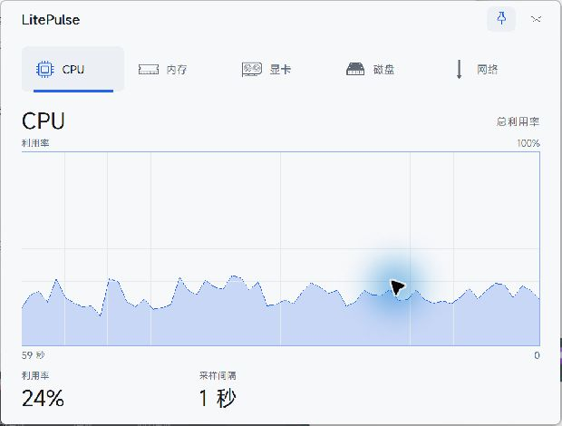
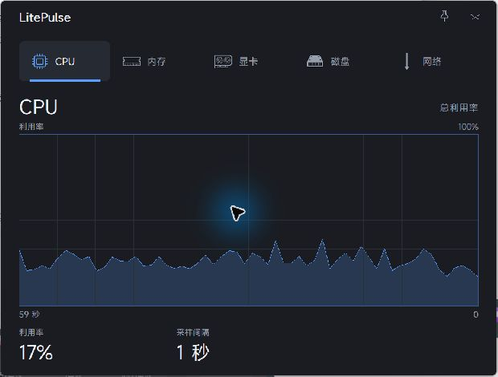

# LitePulse

**English** | [简体中文](README_ZH.md)

LitePulse is a lightweight Windows system monitor that tracks **CPU, memory, GPU, VRAM, disk, and network** activity in real time. Hover over its system tray icon for a compact overview, or click it to open a performance panel with five tabs.

- Built with native Rust + Win32 + GDI. No WebView, .NET runtime, or Electron.
- A single executable, approximately **602 KB** in the current release build.
- No GPU vendor SDK loaded by default; GPU data comes from Windows performance counters and DXGI.
- No network access, telemetry, administrator privileges, or driver installation required.





## Features

- **CPU**: total utilization and a history of the latest 60 samples.
- **Memory**: usage history, used/available capacity, and a memory composition bar.
- **GPU and VRAM**: separate history charts for GPU utilization and dedicated VRAM usage. Automatically selects the adapter with the most dedicated VRAM, typically the discrete GPU.
- **Disk**: activity across all physical disks, read/write curves, and used space on the system drive (usually C:).
- **Network**: download/upload curves and live transfer rates for the default-route network adapter, consistently displayed in bytes per second.
- **Charts**: Task Manager-style grids and filled curves, with the latest data on the right and 60 sample positions. Missing data leaves gaps; changing the sampling interval resets the timeline.
- **Tray icon**: shows CPU utilization by default. Use the tray menu to select memory usage, VRAM usage, or disk activity instead; the selection is saved. The ring updates with each sample and changes color at 70% and 90%.
- **Tray overview**: four progress bars for CPU, memory, VRAM, and disk, plus upload/download rates on one line with arrows beside the values. The overview is 140 DIP wide with rounded borders and supports native Acrylic on Windows 11. The light theme uses a near-white backing to reduce gray tint. Upload arrows are red and download arrows are green. Icons come from the SVG files in `images/`; the overview follows the selected theme and font without taking focus.
- **Tray menu**: show/hide the panel, always on top, start with Windows, sampling interval (1/2/5/30 seconds or 1 minute), theme (system/dark/light), font (MiSans/Microsoft YaHei UI), tray metric, and exit. Right-clicking the main panel opens the same menu.
- **Interaction sampling**: new configurations use a 30-second background interval with automatic acceleration enabled. Hovering over the tray icon, opening the context menu, or showing the panel switches sampling to 1 second; the background interval resumes when all interactions end. Choose a background interval of 1/2/5/30 seconds or 1 minute. The acceleration toggle is disabled at a 1-second base interval. Both settings and the context menu expose these controls; existing configurations keep their selected interval. Charts restart whenever the actual sampling interval changes.
- **Settings page**: click the gear in the upper-right corner to manage always on top, startup, sampling, theme, font, and tray metric, or to hide/exit the app. Changes take effect immediately and use the same handlers as the tray menu. Click the gear again or press Esc to return to monitoring.
- **Unobtrusive operation**: the close button and Esc hide the panel to the tray. The panel stays out of the taskbar and Alt+Tab. Only one instance runs at a time.
- **Display support**: Per-Monitor V2 DPI awareness, position clamping across monitors, light/dark themes, and sampling baseline resets after sleep or lock-screen recovery.
- **Font selection**: uses the locally installed **MiSans** font by default; font files are not bundled. Switch to Microsoft YaHei UI from the tray menu. If MiSans is unavailable, the app falls back automatically to keep the layout consistent.
- **Optional GPU backend**: Windows PDH + DXGI is the default, with low memory usage and support for AMD, Intel, and NVIDIA. NVIDIA NVML is optional and provides more accurate GPU utilization, VRAM usage, and temperature at a cost of roughly 15 MB more memory.

## Resource baseline before the panel redesign

The measurements below are from the previous compact panel. Long-duration performance testing was not repeated for the panel redesign. The current executable is 616,448 bytes.

Test system: Windows 11 Build 26200, 32 GB RAM, RTX 5060 Laptop 8 GB, 3200×2000 at 175% scaling, 1-second sampling, release build.

| Scenario | Working set | Private memory | CPU (% of one core) | GDI / USER objects |
|---|---:|---:|---:|---:|
| Tray only (hidden for 60 seconds) | 21.2 MB | 7.5 MB | 0.29% | 13 / 17 |
| Panel visible (30 seconds) | 21.2 MB | 7.5 MB | 0.47% | 21 / 17 |

- Executable at the time of measurement: `537,088` bytes.
- Startup to tray: approximately 20–30 ms (`starting` → `attached` in the log).
- MiSans adds roughly 1.9 MB to the working set compared with the earlier Microsoft YaHei UI baseline due to font caching. Hiding the panel releases the backing bitmap and HFONT resources, bringing GDI objects back to 13.
- Hidden CPU usage is roughly 0.29% of one core, or about 0.02% across 16 cores. An earlier 10-minute run with Microsoft YaHei UI averaged 0.20% of one core, with a working set of about 19.5 MB and stable handle counts.
- Forcing NVML raises hidden memory usage to roughly 34 MB but enables GPU temperature readings. The default PDH backend better suits the low-overhead goal.

See [the verification record](docs/verification.md) for full measurements and procedures (in Chinese).

## Build

Requirements:

- Windows 10/11 x64.
- Rust stable with the MSVC toolchain (verified with 1.97.1).
- Visual Studio Build Tools and Windows SDK for linking and executable icon resources.
- Access to crates.io to download dependencies on the first build.

```powershell
cargo build --release
# Output: target\release\litepulse.exe
```

Alternatively, run the build script to check formatting, run the full test suite and Clippy, build the release, and copy the executable to `dist/`:

```powershell
powershell -ExecutionPolicy Bypass -File .\scripts\build.ps1
```

Development/diagnostic mode:

```powershell
cargo run --features console -- --probe 5
```

`--probe 5` prints all six metrics, the GPU backend, network adapter, and collection timings every second for comparison with Task Manager or `nvidia-smi`.

## Usage

1. Double-click `litepulse.exe`. A ring icon appears in the system tray and the panel opens.
2. Hover over the tray icon to view usage bars and upload/download rates. Left-click to show/hide the panel. Right-click to open the menu and choose the tray metric for the ring. The font setting applies to both the panel and overview; the menu is drawn by Windows.
3. Select the CPU, Memory, GPU, Disk, or Network tab, or switch tabs with the left/right arrow keys. The upper-right gear opens settings, the pin toggles always on top, and the close icon hides the panel. Esc returns from settings to monitoring, or hides the monitoring panel.
4. Choose **Exit LitePulse** from the context menu to stop the app completely.
5. Enabling **Start with Windows** adds an entry under `HKCU\Software\Microsoft\Windows\CurrentVersion\Run` with the `--startup` argument, which starts the app in the tray without opening the panel. Put the executable in a permanent location before enabling this option. If you move it later, launching it once from the new location automatically updates the Run path.

> Windows 11 usually puts new tray icons in the hidden-icons overflow. Open `^` on the taskbar and drag the LitePulse ring onto the taskbar to keep it visible. This is Windows tray behavior.

Command-line arguments:

- `--startup`: start in the tray with the panel hidden.
- `--probe [seconds]`: collect diagnostic samples without a window; requires a build with `--features console`.
- `--version`: print the version.

## GPU backends and resource tradeoffs

Default data sources:

```text
Windows PDH:  \GPU Engine(*)\Utilization Percentage
              \GPU Adapter Memory(*)\Dedicated Usage
DXGI:         adapter name / dedicated VRAM / LUID
```

The default backend does not load NVIDIA DLLs, uses roughly 19 MB of memory while hidden, and supports AMD, Intel, and NVIDIA. It does not provide temperature readings. GPU utilization approximates the busiest GPU process/engine and may differ from `nvidia-smi` by a few percentage points.

Force NVML (NVIDIA only, with temperature):

```powershell
$env:LITEPULSE_GPU_BACKEND = "nvml"
.\litepulse.exe
```

Disable GPU collection entirely, for example when investigating NVML/PDH compatibility:

```powershell
$env:LITEPULSE_DISABLE_GPU = "1"
.\litepulse.exe
```

## Configuration and logs

- Settings: `%LOCALAPPDATA%\LitePulse\settings.json`
- Log: `%LOCALAPPDATA%\LitePulse\litepulse.log` (startup, backend selection, errors, and shutdown only)

Settings include the theme, background sampling interval, `boost_on_interaction` (automatically switch to 1-second sampling during interaction), always on top, font, window position, and `tray_metric` (`cpu`, `memory`, `gpu`, or `disk`; `gpu` means VRAM usage). Older settings files default to the CPU tray metric. Delete the settings file to restore the defaults: system theme, 30-second background sampling, interaction acceleration enabled, always on top, MiSans, and the CPU ring. You can also set `font_family` to another installed font family; the app checks availability and falls back to Microsoft YaHei UI if needed.

## Known limitations

- No CPU temperature, fan speed, or power readings. These require additional drivers or privileges, which conflict with the low-overhead, no-admin design.
- No per-process rankings, historical database, threshold alerts, or automatic updates.
- Network data comes from the default-route adapter, without aggregation across multiple active adapters. Disk activity is aggregated across physical disks; capacity is shown for the system drive.
- Total VRAM comes from DXGI and may be about 3% lower than the NVIDIA driver reports (7.7 GB vs. 8.0 GB on the test system). Used VRAM is broadly consistent.
- No installer or code signing. Enable startup through the tray menu if needed.
- Primarily verified on Windows 11; Windows 10 1809+ support is best effort.

## Development and testing

```powershell
cargo fmt --all -- --check
cargo test
cargo clippy --all-targets --features console -- -D warnings
cargo build --release
```

The current 37 automated tests cover CPU utilization calculations, rate calculations and resets, the history ring buffer and missing samples, tray metric selection and settings serialization, font family matching, unit formatting, tray tooltip truncation, GPU counter aggregation, tab hit testing and chart coordinates, foreground color preservation on Acrylic, long sampling intervals and network rates, sampling wakeups, interaction state combinations, and disabled toggles. Manual visual test entry points are ignored by default; see [the verification record](docs/verification.md) for commands and screenshots (in Chinese).

`assets/ui/*.alpha` contains 64×64 alpha masks generated from the supplied SVG files and embedded at compile time. After editing an SVG, run `node tools/gen_ui_icons.cjs` in an environment where Node.js can find `sharp` to regenerate the masks. Normal Rust builds require neither Node.js nor an SVG runtime.
