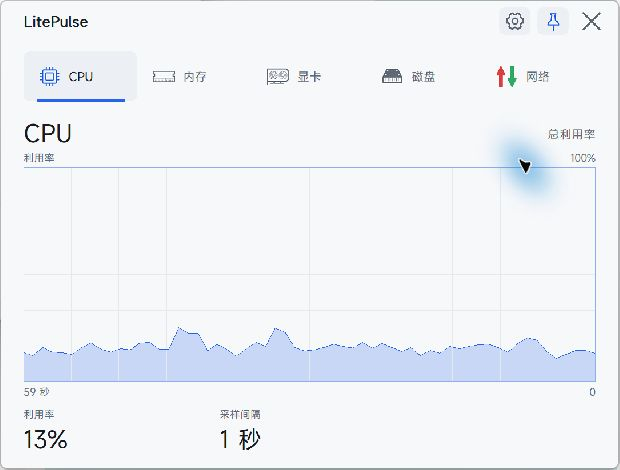
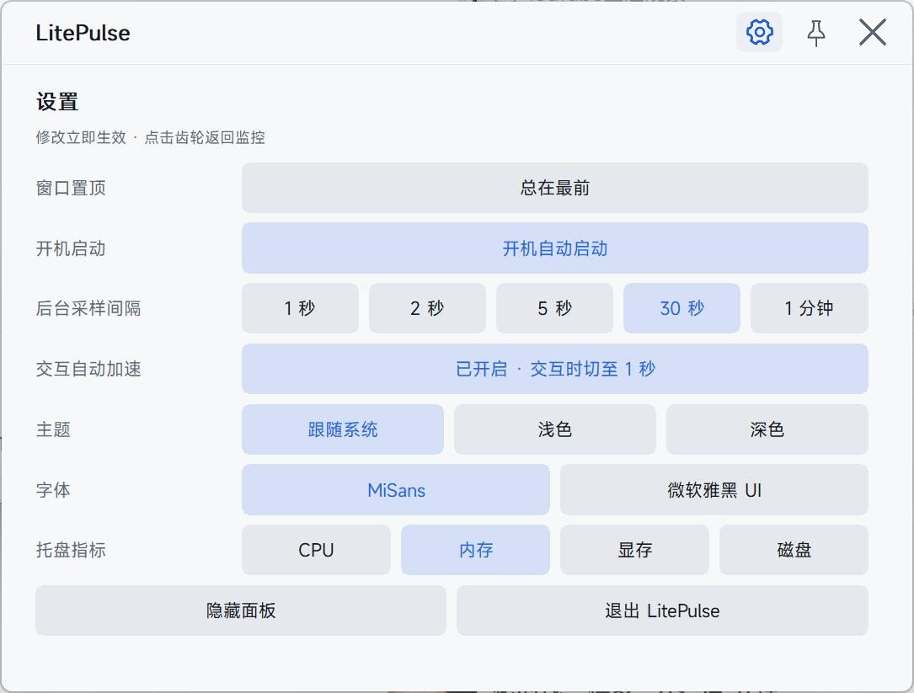
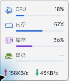

# LitePulse

[English](README.md) | **简体中文**

轻量级 Windows 托盘系统监控工具，实时查看 **CPU、内存、显卡、显存、磁盘和网络** 状态。悬停托盘图标看概览，点击打开性能图表面板。

- **原生便携**：Rust + Win32 + GDI，单文件运行，无需安装。
- **体积小巧**：当前 v0.1.0 release 构建为 **602 KiB**（616,448 字节）。
- **本地运行**：无遥测、无联网请求，无需管理员权限或额外驱动。
- **自适应采样**：默认后台每 30 秒采样，交互时自动加速至 1 秒。

软件目前使用中文界面，顶部语言链接用于切换文档语言。

## 界面预览

### 性能监控面板



### 设置页与托盘概览





## 监控内容

| 标签页 | 显示内容 |
|---|---|
| CPU | 总利用率与近期使用历史 |
| 内存 | 占用历史、已用/可用容量与内存组成条 |
| 显卡 | GPU 利用率与独立显存历史；使用 NVML 且数据可用时显示温度 |
| 磁盘 | 所有物理盘的合计活动、读写速率与系统盘空间占用 |
| 网络 | 默认路由网卡的上传下载历史与实时速率 |

图表保留 **60 个采样位置**，最新数据在右侧；缺失读数保留空档。实际采样间隔变化时，清空旧时间轴并重新积累历史。

托盘圆环可选择显示 **CPU、内存、显存或磁盘活动**，达到 70% 和 90% 时变色。悬停后显示四项占用条与网络速率，上传为红色、下载为绿色。Windows 11 下概览支持原生 Acrylic 磨砂背景，浅色主题采用接近白纸的衬底。

## 快速使用

1. 将 `litepulse.exe` 放到固定目录后运行，托盘图标与监控面板随即出现。
2. **悬停托盘图标**查看概览，**左键点击**显示或隐藏面板。
3. 点击标签或使用**左右方向键**切换图表；右上角**齿轮**打开设置，**图钉**切换窗口置顶。
4. 在设置页调整选项，或右键点击托盘图标/面板打开菜单；修改立即生效并保存。
5. **关闭按钮**只隐藏面板；**Esc** 在设置页返回监控，在监控页隐藏面板。选择**退出 LitePulse**才会完全退出软件。

> Windows 11 可能将托盘图标放进隐藏区域。打开任务栏的 `^`，把 LitePulse 圆环拖到任务栏即可常显。

面板不占任务栏、不进入 Alt+Tab。再次运行 exe 会唤起已有实例，不会常驻第二个进程。

## 设置与采样策略

| 设置 | 可选项 / 新配置默认值 |
|---|---|
| 窗口置顶 | 默认开启 |
| 开机启动 | 默认关闭；开启后启动时只显示托盘，不弹出面板 |
| 后台采样间隔 | 默认 **30 秒**；可选 1、2、5、30 秒或 1 分钟 |
| 交互自动加速 | 默认**开启**；面板、托盘概览或右键菜单打开时切至 1 秒采样 |
| 主题 | 跟随系统（默认）、浅色、深色 |
| 字体 | MiSans（默认），不可用时回退到微软雅黑 UI |
| 托盘指标 | CPU（默认）、内存、显存、磁盘活动 |

所有交互结束后恢复所选后台间隔。关闭自动加速后，交互期间也使用后台间隔。后台间隔为 1 秒时，加速开关禁用，因为已经使用最快采样间隔。已有配置保留原先保存的后台间隔。

MiSans 需在本机安装，软件不附带字体文件。支持 Per-Monitor V2 DPI、多显示器，以及休眠或锁屏恢复后的采样基线重置。

开机启动通过当前用户的 `HKCU\Software\Microsoft\Windows\CurrentVersion\Run` 注册，启动参数为 `--startup`。启用后若移动 exe，在新位置手动运行一次即可更新启动路径。

## 从源码构建

使用 **Windows 10/11 x64**、Rust stable **MSVC 工具链**、Visual Studio Build Tools 和 Windows SDK。首次构建需访问 crates.io 下载依赖。

```powershell
cargo build --release
# 产物：target\release\litepulse.exe
```

构建脚本依次检查格式、运行完整测试和 Clippy、构建 release，并复制到 `dist/litepulse.exe`：

```powershell
powershell -ExecutionPolicy Bypass -File .\scripts\build.ps1
```

## GPU 数据后端

默认使用 **Windows PDH + DXGI**，支持 AMD、Intel 和 NVIDIA；相关计数器可用时不加载显卡厂商 SDK。自动选择独立显存最多的显卡。如果 PDH GPU 计数器不可用，会尝试回退到 **NVIDIA NVML**。

PDH 利用率是最忙 GPU 进程/引擎的近似值，可能与任务管理器或 `nvidia-smi` 不同；DXGI 显存总量也可能与驱动报告略有差异。GPU 温度仅在 NVML 后端可用，需要兼容的 NVIDIA 驱动，并会增加内存占用。

手动指定 NVML 时，先退出正在运行的实例，再从 PowerShell 启动：

```powershell
$env:LITEPULSE_GPU_BACKEND = "nvml"
.\litepulse.exe
```

完全关闭 GPU 采集时，先退出软件，再使用：

```powershell
$env:LITEPULSE_DISABLE_GPU = "1"
.\litepulse.exe
```

## 配置与日志

- 设置：`%LOCALAPPDATA%\LitePulse\settings.json`
- 本地诊断日志：`%LOCALAPPDATA%\LitePulse\litepulse.log`

设置保存主题、后台间隔（`interval_ms`）、交互加速（`boost_on_interaction`）、置顶、字体、窗口位置和托盘指标。`tray_metric` 中的 `gpu` 指**显存占用**，不是 GPU 利用率。开机启动单独保存在 Windows Run 注册表项中。

恢复默认设置时，先退出 LitePulse，删除 `settings.json` 后重新运行；这不会删除开机启动注册表项。也可以在软件关闭时，将 `font_family` 改为其他已安装的字体族名；不可用时自动回退到微软雅黑 UI。

## 限制与性能说明

- 不提供 CPU 温度、风扇、功耗、每进程排行、历史数据库、阈值告警或自动更新。
- 网络读取默认路由网卡，不合并多张同时工作的网卡；磁盘活动为物理盘合计，容量显示系统盘。
- 主要在 Windows 11 验证，Windows 10 1809+ 尽力兼容；Acrylic 取决于系统支持，不支持时回退为实色背景。
- exe 未签名，无安装程序。

当前 exe 体积于 **2026-11-03** 核对。此前的 CPU、内存测量对应特定构建与设置，适用范围和结果见[验证记录](docs/verification.md)与[采样性能排查](docs/performance-investigation.md)。

## 开发与诊断

```powershell
cargo fmt --all -- --check
cargo test
cargo clippy --all-targets --features console -- -D warnings
cargo build --release
```

输出五秒的指标、数据源与采集耗时报告：

```powershell
cargo run --features console -- --probe 5
```

命令行选项：`--startup`（仅托盘启动）、`--probe [秒数]`（诊断采样，使用 console 构建查看输出）、`--version`（输出版本）。手动视觉和性能诊断方法见上方验证记录。

UI 图标以 64×64 透明度蒙版嵌入 `assets/ui/`。修改 `images/` 下的 SVG 后，可在 Node.js 能找到 `sharp` 的环境中运行 `node tools/gen_ui_icons.cjs` 重新生成；普通 Rust 构建不需要 Node.js 或 SVG 运行时。

## 许可证

[MIT](LICENSE)
